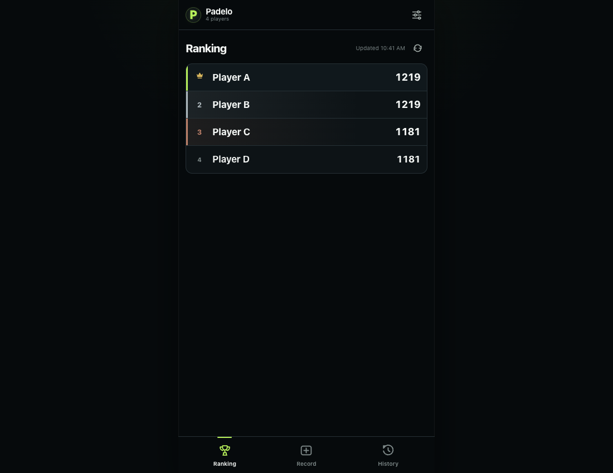

# Padelo

Padelo is a small, mobile-first padel ranking application. A Go HTTP service owns authentication, Elo calculations, and PostgreSQL persistence; the browser client is plain HTML, CSS, and JavaScript. An optional Telegram webhook exposes the same ranking workflow to an allowlisted chat.



The screenshot uses fictional players from a disposable local database.

## Features

- Public rankings, player profiles, match history, and next-match details
- Admin-only player management, Elo adjustments, match recording, rollback, and next-match scheduling
- Four-player team Elo updates with score weighting
- Installable progressive web app with no frontend build step
- Optional Telegram commands with webhook authentication and replay protection
- Revocable server-side admin sessions stored in secure cookies

## Technology

- Go 1.26.10+ using `net/http`
- PostgreSQL through `pgx`
- Vanilla HTML, CSS, and JavaScript in `web/`
- Render deployment configuration in `render.yaml`

## Quick start

Clone this standalone public edition, then create an empty local PostgreSQL database. It contains no real player data, private credentials, or production connections.

```bash
git clone https://github.com/Wolfvus/padelo.git
cd padelo
```

If you have Docker, start a disposable local database (these credentials are for local development only):

```bash
docker run --name padelo-dev -e POSTGRES_USER=padelo -e POSTGRES_PASSWORD=padelo \
  -e POSTGRES_DB=padelo -p 127.0.0.1:5432:5432 -d postgres:18
```

Configure the application:

```bash
cp .env.example .env
```

Set `WEB_ADMIN_PASSWORD` in `.env` to a unique password of at least 16 characters. Then run:

```bash
set -a
source .env
set +a
go run ./cmd/padelo
```

Telegram is disabled by default. Use the admin password to unlock recording, then add your own players through the player-management screen.

The application starts at `http://127.0.0.1:8080/` with the example origin and port. Startup creates missing tables and indexes but never seeds or resets data. Use a local or disposable database only during development.

## Verification

```bash
gofmt -w ./cmd ./internal
go test ./...
go test -race ./...
go vet ./...
go build ./...
```

## Engineering decisions

- Pure Elo calculations are separate from HTTP and persistence so scoring can be tested independently.
- Match recording and rollback use database transactions; administrative access is enforced on the server.
- Revocable sessions store token hashes rather than raw browser credentials in PostgreSQL.
- The browser uses native modules and a shared API client, with no frontend build pipeline.

## Repository map

```text
cmd/padelo/       process entry point and server lifecycle
internal/config/  environment loading and validation
internal/elo/     pure Elo calculations
internal/httpapp/ routes, middleware, and HTTP handlers
internal/security/session and login security helpers
internal/store/   PostgreSQL schema and data operations
web/              static progressive web application
docs/             system and operational documentation
```

## Documentation

- [Architecture](docs/architecture.md)
- [HTTP API](docs/api.md)
- [Data model](docs/data-model.md)
- [Frontend](docs/frontend.md)
- [Telegram integration](docs/telegram.md)
- [Development guide](docs/development.md)
- [Deployment guide](docs/deployment.md)
- [Operations runbook](docs/operations.md)
- [Security model](docs/security.md)

Contributor constraints are recorded in [AGENTS.md](AGENTS.md).
